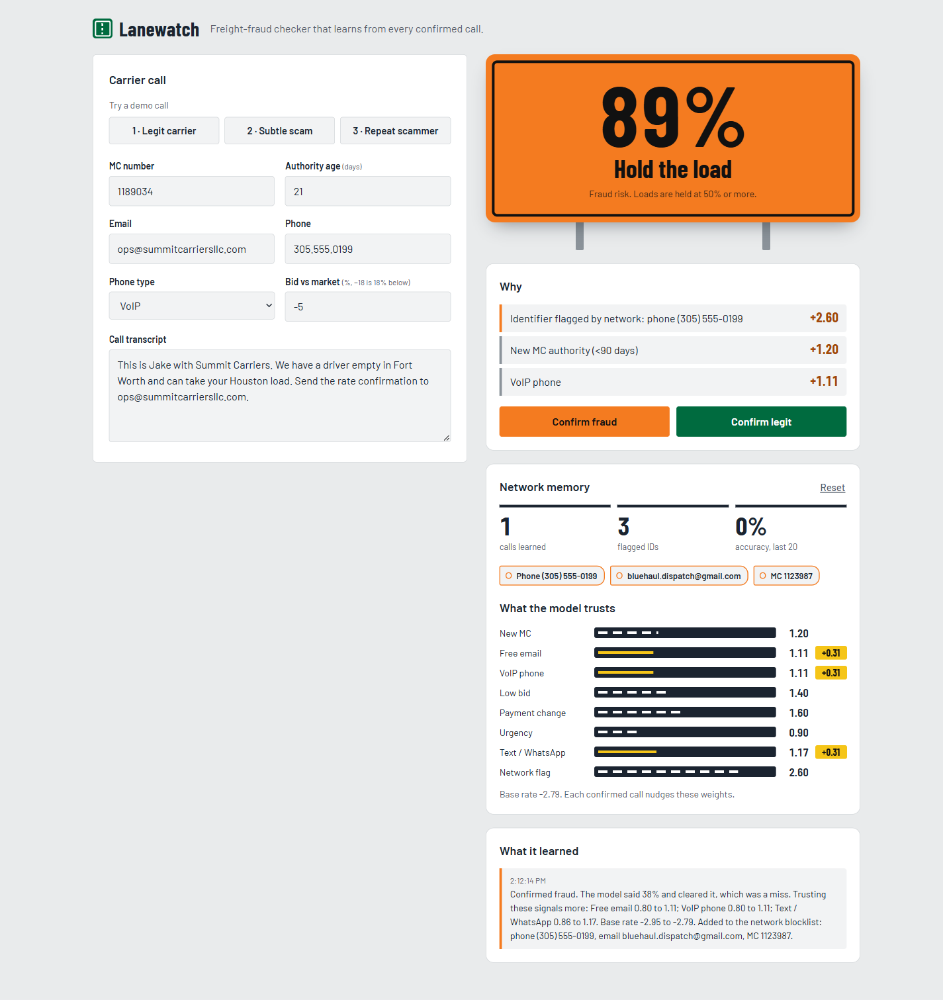

# Lanewatch

**A freight-fraud checker for brokers that gets smarter with every confirmed call.**

## The problem

Double brokering and carrier identity theft cost the US freight industry hundreds of millions of dollars a year. Scammers buy fresh MC numbers, use Gmail and VoIP lines, underbid the market, and push brokers onto WhatsApp or ask to "update payment details." Today's vetting tools are static rule lists. They miss subtle scams, and once a scammer is caught, nothing stops them from calling the next broker with a new MC and the same phone.

## How it learns

1. **Score.** Each call is turned into 8 signals: new MC (<90 days), free email domain, VoIP phone, bid 15%+ below market, payment/factoring change request, urgency words, moving the call to text/WhatsApp, and an identifier already flagged by the network. A logistic model turns them into a fraud probability.
2. **Explain.** The verdict shows the %, "Hold the load" or "Safe to book", and the reasons ranked by weight.
3. **Confirm.** When the broker confirms fraud or legit, Lanewatch runs one online gradient step on the log-loss (`w += lr · (label − p) · x`), so signals that showed up in a missed scam gain weight and signals on a false alarm lose weight.
4. **Remember.** Confirmed fraud adds the phone (digits only), email, and MC to the network blocklist. The next call that reuses any of them lights up the strongest signal in the model.
5. **Show it.** The Network memory panel shows calls learned, flagged identifiers, accuracy over the last 20 calls, and live model weights. Every update is logged in plain words.

## Design rationale: why road signage

Brokers and dispatchers spend their day thinking about lanes, loads and highways, so Lanewatch borrows that visual language instead of a generic SaaS dashboard.

- **The verdict is a highway sign.** It is green with reflective white for "Safe to book" and DOT construction orange with black for "Hold the load." The % is set in Barlow Condensed, a typeface modeled on US highway lettering. The sign flips in on every check. It's the one bold element, and everything else stays quiet.
- **Learning looks like lane markings.** The 8 signal weights are dashed white lines on asphalt. After a confirmed call, the lines that changed flash lane-yellow and show their delta, so judges can see the model change.
- **Flagged identifiers are freight tags.** Blocked phones, emails and MCs slide into the network memory as tagged chips.
- **Palette.** Six colors from the roadside: asphalt navy, concrete grey, sign green, DOT orange, reflective white and lane yellow. Light mode reads as concrete in daylight, dark mode as asphalt at night. Text meets AA contrast, focus is always visible, and `prefers-reduced-motion` turns off the flip and the flashes.

## The $1B path

1. **Per-call pricing.** Brokers pay per checked call. One prevented theft ($50k+ load) pays for years of checks.
2. **Network-effect moat.** Every confirmed call from every broker trains the shared model and grows the blocklist. A scammer caught by one broker is blocked for all of them. More brokers mean better detection, and better detection brings in more brokers.
3. **Carrier-trust API.** The same score, sold to shippers, factoring companies, and cargo insurers who need to know whether a carrier is real before they pay, fund, or underwrite.

## Demo steps

1. Click **1 · Legit carrier**. The green sign reads about **5%**, Safe to book.
2. Click **2 · Subtle scam** (Gmail, VoIP, WhatsApp). The sign reads about **38%**, Safe to book. The model misses it.
3. Click **Confirm fraud**. The free email, VoIP and WhatsApp lane lines flash yellow with +0.31, and the phone, email and MC slide into the network blocklist. The log explains each change.
4. Click **3 · Repeat scammer** (same phone, new MC, clean company email). The sign flips to orange: about **89%**, Hold the load. Top reason: phone flagged by the network.
5. Optional: Click **Reset** in Network memory to start over.

## Tech

- One static `index.html`: vanilla JS, no backend, no API keys, no build step.
- Logistic regression with online SGD, written in about 40 lines.
- State (weights, blocklist, history, log) is kept in `localStorage` and wrapped in try/catch.
- Responsive layout, light and dark mode, visible keyboard focus. Fonts: Barlow and Barlow Condensed from Google Fonts.
- Screenshots for the gallery are in `/screenshots` (desktop and mobile, light and dark).
- Deployed on Vercel.

Run locally: open `index.html` in a browser, or `python -m http.server`.
